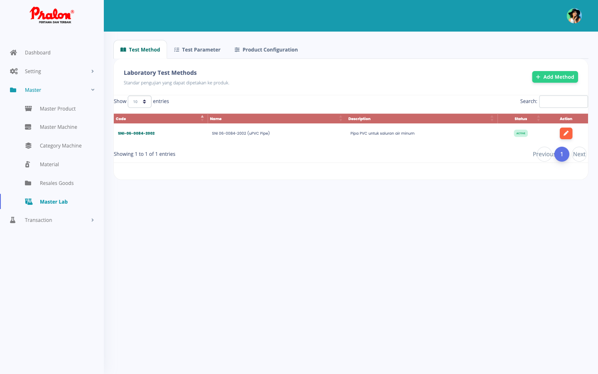
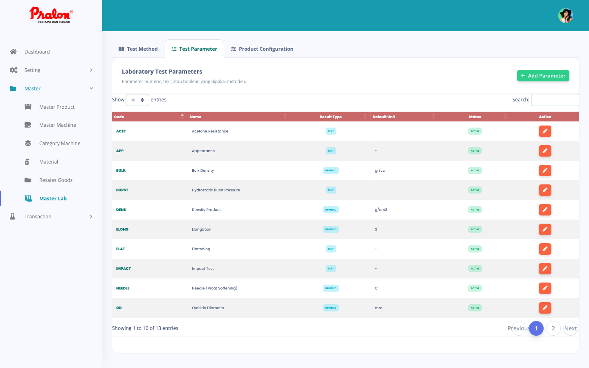
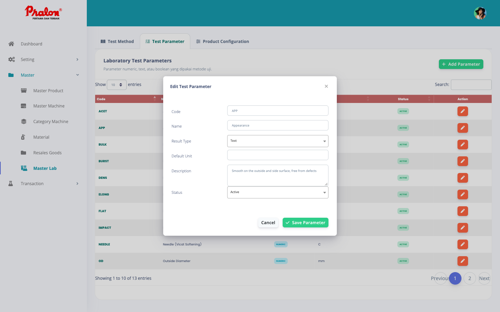
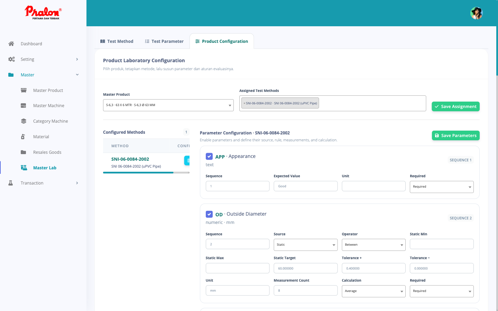
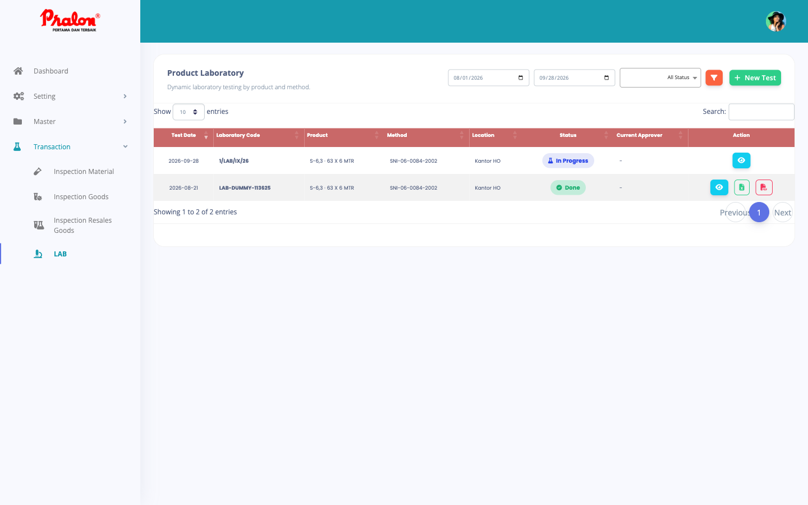
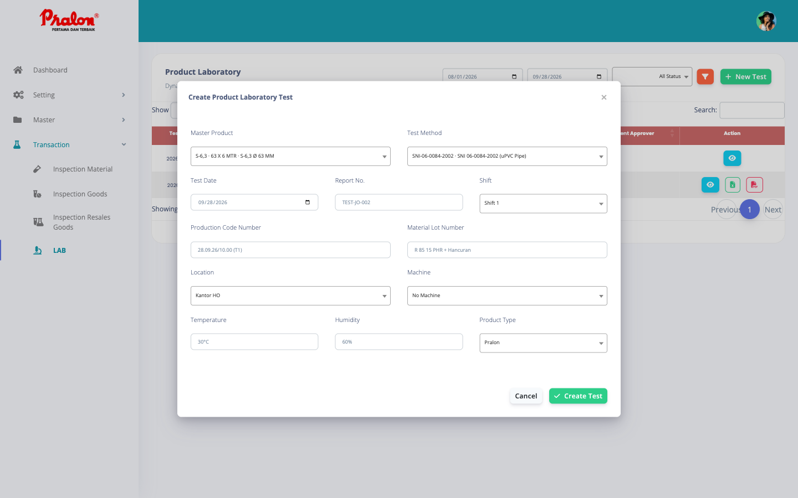
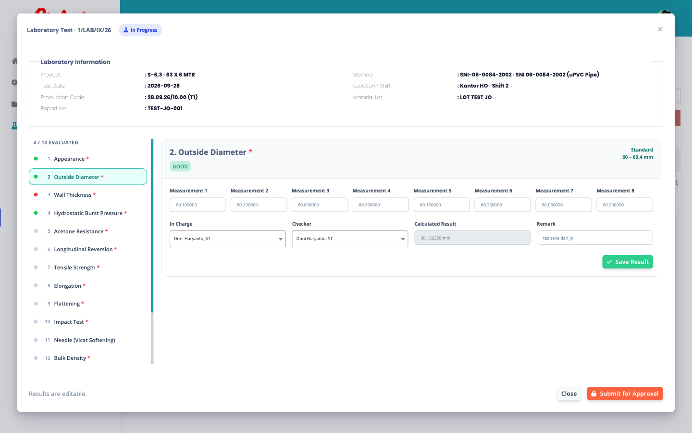
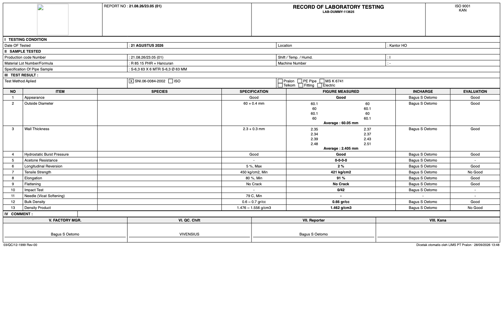

# Manual Modul LAB — LIMS Pralon

Panduan pemakaian modul Laboratorium pada LIMS PT Pralon, dari penyiapan master
sampai cetak *Record of Laboratory Testing*.

Dokumen ini ditujukan untuk tiga peran:

| Peran | Yang dikerjakan | Halaman |
|---|---|---|
| Admin / IT | Menyiapkan metode, parameter, dan aturan evaluasi per produk | `Master → Master Lab` |
| Petugas lab (QC) | Membuat transaksi uji dan mengisi hasil pengukuran | `Transaction → LAB` |
| Atasan / approver | Menyetujui atau mengembalikan hasil uji | `Dashboard` |

---

## 1. Alur kerja

Modul ini berjalan satu arah. Setiap tahap mengunci tahap sebelumnya, jadi data
yang sudah disetujui tidak bisa diam-diam berubah.

```
SEKALI DI AWAL                        SETIAP PENGUJIAN
──────────────                        ────────────────
Test Method                           New Test  ──►  Isi hasil  ──►  Submit
     │                                                                  │
     ▼                                                                  ▼
Test Parameter                                                     Approval
     │                                                                  │
     ▼                                                                  ▼
Product Configuration  ─────────────────────────────────────────►  Report PDF/Excel
   (aturan evaluasi)                                             (form 03/QC/12-1999)
```

Bagian kiri dikerjakan sekali, lalu hanya diubah kalau standar pengujian berubah.
Bagian kanan dikerjakan setiap kali ada sampel yang diuji.

**Hal terpenting untuk dipahami:** saat transaksi dibuat, sistem memotret
(*snapshot*) seluruh aturan evaluasi yang berlaku saat itu ke dalam transaksi
tersebut. Kalau besok Anda mengubah standar di Master Lab, transaksi lama tetap
memakai standar lamanya. Ini disengaja supaya hasil uji yang sudah tercetak bisa
dipertanggungjawabkan.

---

## 2. Setup Master Lab

Buka `Master → Master Lab`. Ada tiga tab yang harus dikerjakan **berurutan**.

### 2.1 Tab Test Method



Metode adalah standar pengujian, misalnya SNI 06-0084-2002 untuk pipa uPVC.

Klik **Add Method**, lalu isi:

| Field | Keterangan |
|---|---|
| Code | Kode unik metode, misal `SNI-06-0084-2002`. Kode ini yang tercetak di report. |
| Name | Nama lengkap, misal `SNI 06-0084-2002 (uPVC Pipe)` |
| Description | Penjelasan bebas, tidak tercetak di report |
| Status | `Active` supaya bisa dipakai. Metode `Inactive` tidak muncul saat membuat transaksi. |

### 2.2 Tab Test Parameter



Parameter adalah butir yang diukur: Outside Diameter, Wall Thickness, Tensile
Strength, dan seterusnya. Parameter dibuat sekali lalu dipakai ulang oleh metode
mana pun.

Klik **Add Parameter**:

| Field | Keterangan |
|---|---|
| Code | Kode singkat, misal `OD`, `WT`, `TENS` |
| Name | Nama yang tercetak di kolom **ITEM** pada report |
| Result Type | `Numeric` (angka), `Text` (pengamatan), atau `Boolean` (ya/tidak). **Tidak bisa diubah setelah dipakai transaksi.** |
| Default Unit | Satuan bawaan, misal `mm`, `kg/cm2`, `%`. Bisa ditimpa per produk. |
| Description | **Tercetak di kolom SPECIES pada report.** Lihat catatan di bawah. |
| Status | `Active` / `Inactive` |



> **Kolom Description itu penting.** Isinya langsung tercetak di kolom SPECIES
> pada form cetak, persis seperti tulisan di formulir kertas. Contoh untuk
> Appearance: `Smooth on the outside and side surface, free from defects`.
> Untuk parameter yang di formulir punya beberapa baris keterangan, tulis saja
> multi-baris — barisnya dipertahankan saat dicetak.

#### Memilih Result Type

| Result Type | Cara petugas mengisi | Cara sistem menilai |
|---|---|---|
| **Numeric** | Satu atau beberapa kotak angka | Dihitung (rata-rata/min/maks) lalu dibandingkan dengan batas |
| **Text** | Kotak teks bebas | Dibandingkan persis dengan Expected Value |
| **Boolean** | Dropdown Yes/No | Dibandingkan dengan nilai yang diharapkan |

### 2.3 Tab Product Configuration



Di sinilah metode dan parameter dirangkai menjadi aturan nyata untuk satu produk.

**Langkah 1 — Pasang metode ke produk.** Pilih produk di **Master Product**,
pilih satu atau beberapa metode di **Assigned Test Methods**, lalu klik
**Save Assignment**.

**Langkah 2 — Atur parameternya.** Metode yang sudah terpasang muncul di daftar
**Configured Methods** sebelah kiri. Klik tombol konfigurasi pada barisnya, dan
panel kanan akan menampilkan seluruh parameter aktif.

Centang parameter yang dipakai metode ini. Parameter yang tidak dicentang
mengkerut jadi satu baris judul saja, jadi Anda bisa langsung melihat mana yang
benar-benar diuji. Parameter ditampilkan **urut sesuai Sequence**, sama dengan
urutan di formulir cetak.

Isi kolom-kolom berikut, lalu klik **Save Parameters**:

| Field | Berlaku untuk | Keterangan |
|---|---|---|
| Sequence | Semua | Nomor urut di report (kolom **NO**) |
| Source | Numeric | `Static` = batas diketik manual. `Product Field` = batas diambil otomatis dari Master Product. |
| Operator | Numeric | Cara membandingkan — lihat tabel berikutnya |
| Static Min / Max / Target | Numeric, Source = Static | Batas bawah, batas atas, dan nilai acuan |
| Min / Max / Target Product Field | Numeric, Source = Product Field | Kolom mana di Master Product yang dipakai (`min_od`, `max_od`, `avg_od`, `min_wt`, `max_wt`, `avg_wt`) |
| Tolerance + / − | Numeric | Toleransi terhadap Target. Ini yang membuat report tercetak sebagai `60 + 0.4`. |
| Expected Value | Text / Boolean | Nilai yang dianggap benar, misal `Good` |
| Unit | Semua | Satuan; kosongkan untuk memakai Default Unit parameter |
| Measurement Count | Numeric | Berapa titik diukur. Contoh: Outside Diameter = 8 titik. |
| Calculation | Numeric | `Average`, `Minimum`, `Maximum`, atau `None` — cara meringkas titik-titik tadi jadi satu angka |
| Required | Semua | `Required` menghalangi Submit kalau belum diisi |

#### Tabel Operator

| Operator | Dinilai GOOD kalau | Tercetak di report sebagai |
|---|---|---|
| `Between` | nilai berada di antara Min dan Max | `60 + 0.4` bila ada Toleransi, selain itu `0.6 ~ 0.7` |
| `≥ Minimum` | nilai ≥ Min | `450 kg/cm2, Min` |
| `≤ Maximum` | nilai ≤ Max | `5 %, Max` |
| `Equal / Target` | nilai sama dengan Target | `60` |

#### Kapan memakai Product Field

Pakai `Static` kalau batasnya sama untuk semua ukuran produk — misalnya Tensile
Strength minimal 450 kg/cm² untuk semua pipa uPVC.

Pakai `Product Field` kalau batasnya mengikuti ukuran pipa. Outside Diameter pipa
63 mm jelas berbeda dengan pipa 110 mm, dan angkanya sudah tersimpan di Master
Product. Dengan Product Field, Anda cukup mengatur sekali dan semua ukuran
mengikuti datanya sendiri-sendiri.

---

## 3. Membuat dan mengisi transaksi uji

Buka `Transaction → LAB`.



Daftar disaring berdasarkan rentang **tanggal uji** dan **status**. Bawaannya
satu bulan terakhir — kalau transaksi yang dicari tidak muncul, mundurkan dulu
tanggal awalnya lalu klik tombol corong.

### 3.1 Membuat transaksi baru

Klik **New Test**.



| Field | Wajib | Keterangan |
|---|---|---|
| Master Product | ya | Menentukan metode apa saja yang tersedia |
| Test Method | ya | Hanya metode yang sudah dipasang ke produk ini yang muncul |
| Test Date | ya | Tanggal pengujian, tercetak di bagian **I TESTING CONDITION** |
| Report No. | – | Nomor laporan internal |
| Shift | – | Shift 1 / 2 / 3, tercetak sebagai angka Romawi |
| Production Code Number | – | Kode produksi sampel |
| Material Lot Number | – | Lot atau formula material |
| Location | – | Lokasi pengujian. Menentukan pilihan mesin. |
| Machine | – | Mesin produksi sampel; hanya mesin di lokasi tersebut yang muncul |
| Temperature | – | Suhu ruang saat uji, misal `30°C` |
| Humidity | – | Kelembapan, misal `60%` |
| Product Type | – | Pralon / PE Pipe / MS K 6741 / Telkom / Fitting / Electric — jadi centang di report |

Klik **Create Test**. Sistem membuat kode transaksi otomatis (format
`1/LAB/IX/26`) dan langsung membangkitkan seluruh baris parameter sesuai
konfigurasi produk-metode tadi. Status awal: **Draft**.

### 3.2 Mengisi hasil pengukuran

Klik ikon mata pada baris transaksi.



Modal terbagi tiga:

- **Laboratory Information** di atas — ringkasan transaksi, tidak bisa diubah.
- **Daftar parameter** di kiri — satu parameter satu baris, dengan titik warna:
  hijau = GOOD, merah = NO GOOD, abu-abu = belum dinilai. Di atasnya ada
  penghitung `4 / 13 EVALUATED`.
- **Panel isian** di kanan — hanya menampilkan parameter yang sedang dipilih.

Isi satu parameter, klik **Save Result**, lalu pindah ke parameter berikutnya.
Setiap parameter disimpan sendiri-sendiri, jadi pekerjaan bisa dicicil dan
ditinggal dulu. Setelah menyimpan, sistem langsung menghitung dan menilai, titik
warna di kiri berubah, dan penghitung naik — tanpa memindahkan Anda dari
parameter yang sedang dikerjakan.

Bentuk isian mengikuti Result Type parameter:

- **Numeric** — sejumlah kotak Measurement sesuai Measurement Count. Kolom
  *Calculated Result* terisi otomatis dari Calculation, misalnya rata-rata 8
  titik.
- **Text** — satu kotak Observation / Result.
- **Boolean** — dropdown Yes / No.

Semua tipe punya **In Charge** (petugas yang mengukur), **Checker** (yang
memeriksa), dan **Remark** (catatan bebas per parameter).

### 3.3 Comment

Item **Comment** di bawah daftar parameter mengisi bagian **IV COMMENT** pada
form cetak. Gunakan untuk catatan yang berlaku bagi seluruh pengujian, bukan per
parameter. Bisa diubah selama transaksi belum dikunci.

### 3.4 Submit for Approval

Setelah semua parameter wajib terisi, klik **Submit for Approval**. Transaksi
terkunci, semua isian jadi tidak bisa diubah, dan masuk ke antrean persetujuan.

Kalau tombolnya ditolak dengan pesan *Required result is incomplete*, berarti
masih ada parameter bertanda bintang merah yang belum disimpan. Cari titik abu-abu
di daftar sebelah kiri.

---

## 4. Persetujuan

Approver membuka **Dashboard**, memilih transaksi laboratorium yang menunggu,
lalu mengisi **Decision**:

- **Approve** — lanjut ke step approval berikutnya, atau selesai (status **Done**)
  kalau sudah step terakhir.
- **Return for Revision** — transaksi kembali terbuka (status **Revision**) supaya
  petugas lab bisa memperbaiki, lalu submit ulang.

Kolom **Approval Remark** wajib diisi supaya alasan keputusan tercatat. Seluruh
riwayat persetujuan bisa dilihat di item **Approval History** pada modal detail.

Urutan approver diatur di `Setting → Approval`, dipisah per lokasi.

---

## 5. Cetak report

Tombol **Excel** dan **PDF** hanya muncul untuk transaksi berstatus **Approval**
atau **Done** — hasil yang belum disetujui memang tidak boleh dicetak. Tombolnya
ada di dua tempat: kolom Action pada tabel, dan footer modal detail.



Keduanya memakai tata letak yang sama, mengikuti formulir **03/QC/12-1999 Rev-00**.
PDF untuk dicetak dan diarsipkan; Excel untuk diedit dulu bila perlu.

Peta isi report:

| Bagian form | Diambil dari |
|---|---|
| REPORT NO | Field Report No. di New Test |
| Date OF Tested | Test Date, ditulis dalam bahasa Indonesia |
| Production code Number | Field yang sama di New Test |
| Material Lot Number/Formula | Field Material Lot Number |
| Specification Of Pipe Sample | Seri, ukuran, dan marking Master Product |
| Shift / Temp. / Humd. | Shift (angka Romawi), Temperature, Humidity |
| Machine Number | Mesin yang dipilih |
| Test Method Aplied | Centang otomatis dari kode metode |
| Centang jenis produk | Field Product Type |
| Kolom NO | Sequence pada Product Configuration |
| Kolom ITEM | Nama parameter |
| Kolom SPECIES | Description parameter di Master Lab |
| Kolom SPECIFICATION | Dirakit dari Operator, batas, dan toleransi |
| Kolom FIGURE MEASURED | Titik-titik pengukuran dan hasil hitungannya |
| Kolom INCHARGE | Petugas In Charge parameter tersebut |
| Kolom EVALUATION | Penilaian sistem: Good / No Good |
| IV COMMENT | Item Comment di modal detail |
| Blok tanda tangan | Nama pengaju dan para approver yang sudah menyetujui |

---

## 6. Status transaksi

| Status | Arti | Bisa diubah? |
|---|---|---|
| **Draft** | Baru dibuat, belum ada hasil tersimpan | ya |
| **In Progress** | Sebagian hasil sudah disimpan | ya |
| **Approval** | Sudah disubmit, menunggu persetujuan | tidak |
| **Done** | Seluruh approval selesai | tidak |
| **Revision** | Dikembalikan approver untuk diperbaiki | ya |

Report hanya tersedia pada status **Approval** dan **Done**.

---

## 7. Masalah yang sering muncul

**Transaksi tidak muncul di daftar.**
Filter tanggal bawaannya satu bulan terakhir, sedangkan yang dipakai adalah
*tanggal uji*, bukan tanggal pembuatan. Mundurkan tanggal awal lalu klik corong.

**Test Method kosong saat membuat New Test.**
Produk tersebut belum dipasangi metode. Buka `Master Lab → Product Configuration`,
pilih produknya, isi Assigned Test Methods, lalu Save Assignment.

**Muncul pesan "No valid active parameter could be generated".**
Metodenya sudah terpasang tetapi belum ada parameter yang dicentang, atau semua
parameternya berstatus Inactive. Atur di panel Parameter Configuration.

**Mesin tidak muncul di dropdown.**
Daftar mesin disaring berdasarkan Location. Pilih lokasi dulu; kalau memang
lokasi itu tidak punya mesin, biarkan `No Machine`.

**Hasil dinilai NO GOOD padahal menurut petugas bagus.**
Periksa aturannya di Product Configuration: Operator, batas Min/Max, dan
Calculation. Ingat bahwa transaksi memakai aturan yang berlaku *saat transaksi
dibuat*; mengubah master sekarang tidak mengubah transaksi lama.

**Kolom SPECIES kosong di report.**
Description parameter di Master Lab belum diisi.

**Tombol PDF/Excel tidak kelihatan.**
Transaksi belum sampai status Approval. Selesaikan pengisian lalu Submit for
Approval.
